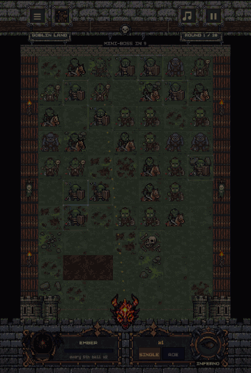
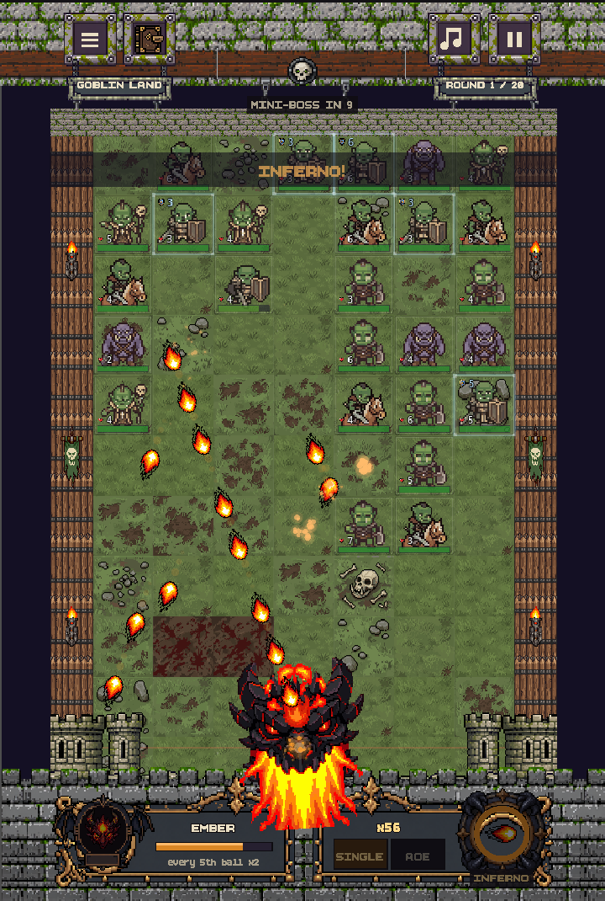
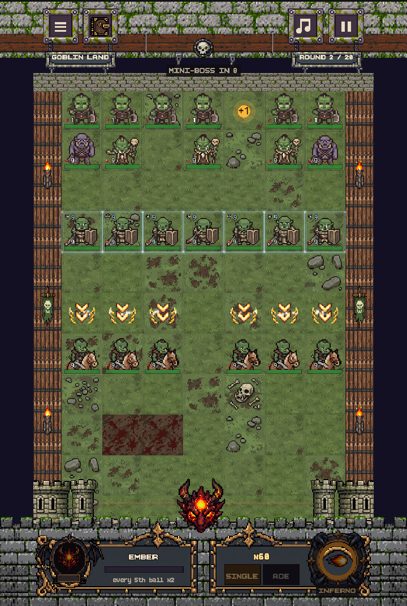
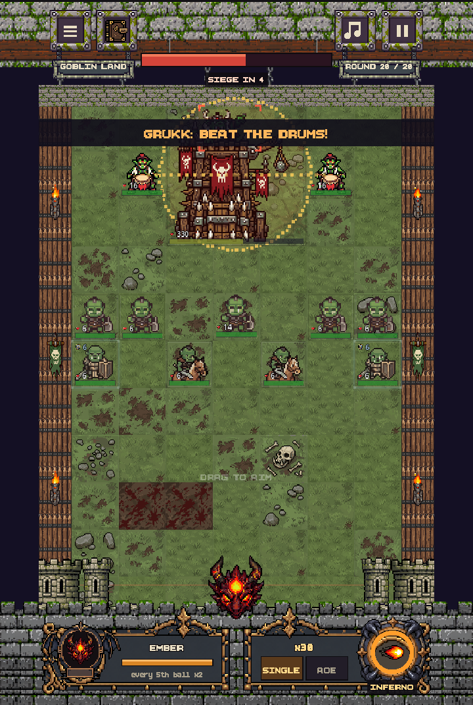
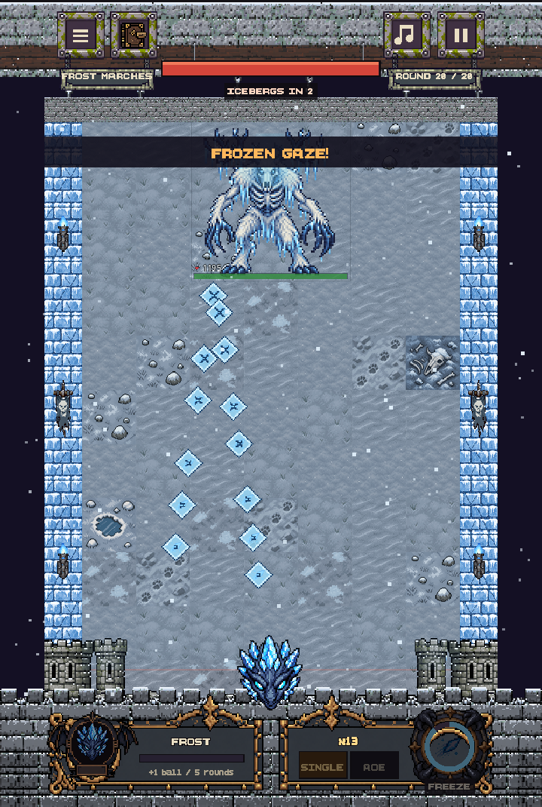
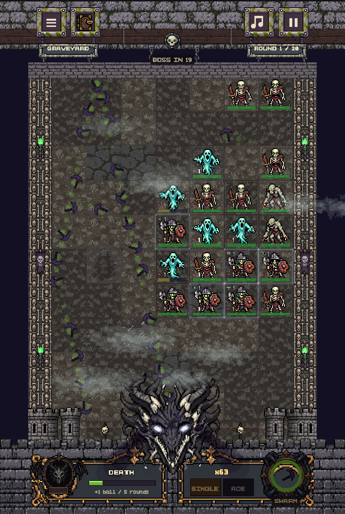
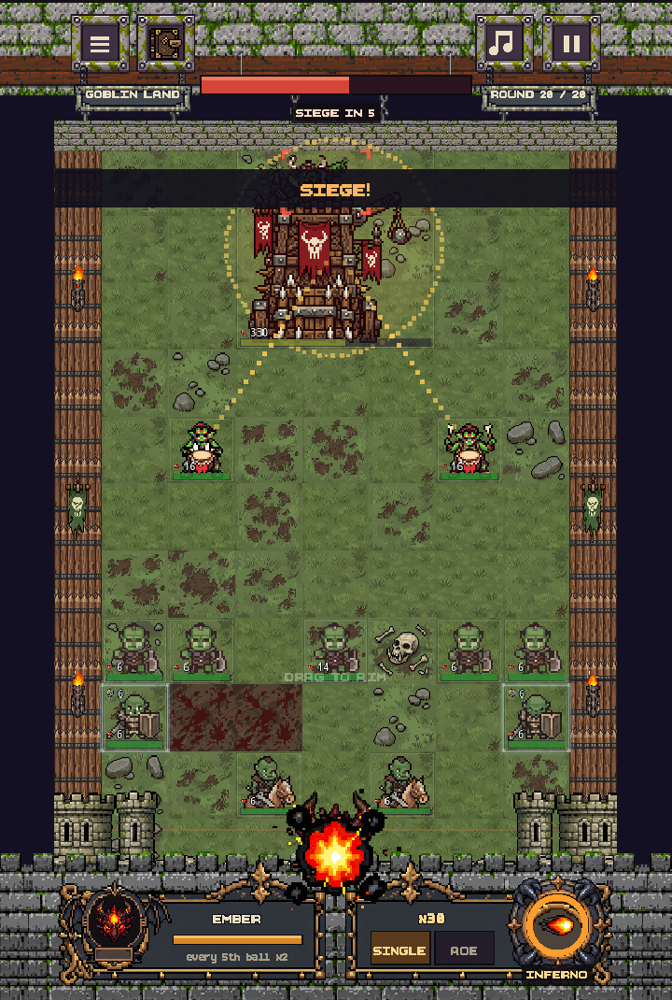
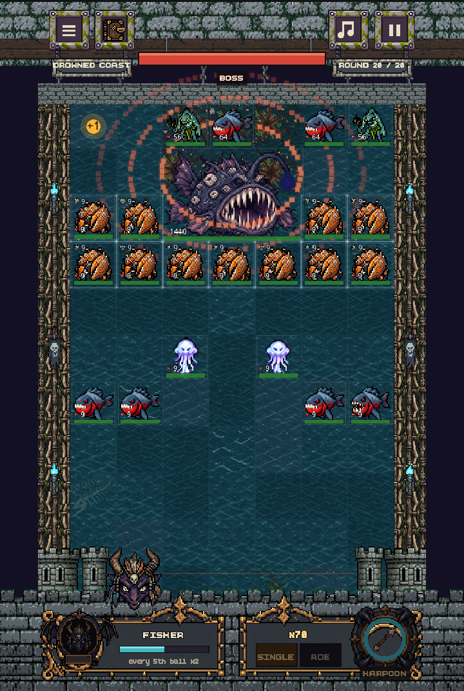
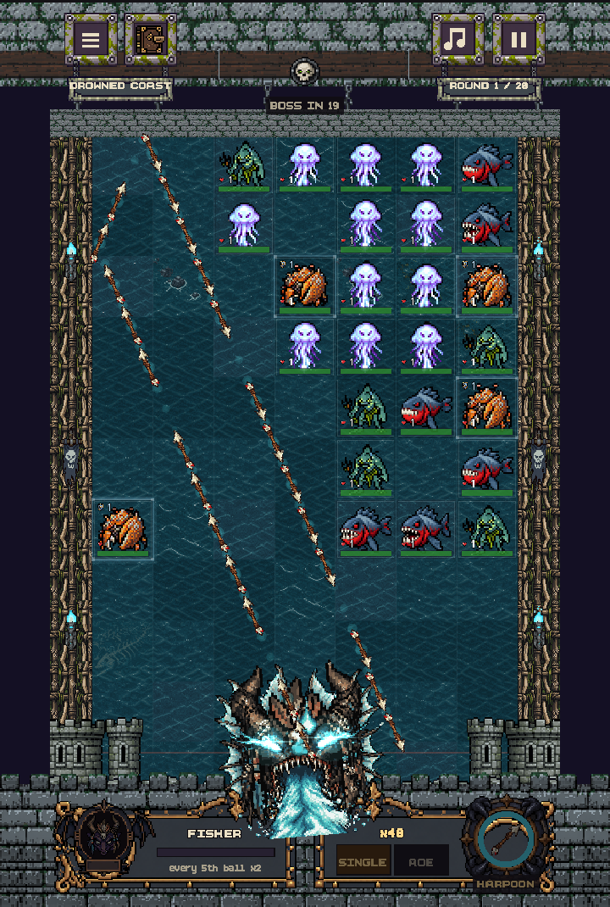

# 🐉 BBdragon

*Bounce fireballs, freeze bosses, feed the dragon.*

### [▶ Play it in the browser](https://40panos.github.io/-dragon/)

Desktop or phone, nothing to install.

## About

I started BBdragon for fun, to learn how to use AI tools to get the best result I can in a field I had never touched. Before this I had never made a game. I didn't know Godot, I had never drawn pixel art and I had no idea how animation works.

So I set myself a challenge: treat the AI tools like a small team. I decide what the game is, how it should look and feel, and what's good enough. They help me build it, and I review, fix and push back until it looks right.

It's still ongoing, and every week it grows a bit more.

## The game

If you've played **BBTAN**, you already know how it works: aim, shoot a volley of bouncing balls, and clear the blocks before they reach the bottom. BBdragon takes that idea and turns the blocks into monsters with their own tricks, and you into a dragon.

**4 worlds.** Goblin Land, Frost Marches, Graveyard and Drowned Coast. Each one has its own enemies, scenery and boss.

**4 dragons, and each one evolves.** Ember throws fireballs, Frost throws ice shards, Death throws spinning scythes and the Fisher throws harpoons. When you fire their special, they transform into a bigger form for that turn.

**28 enemies that don't just sit there.** Orc riders charge forward two rows at once. Shield knights block until the shield breaks. Warlocks summon minions. Snow wolves move faster in packs. Ghosts shrug off weak hits.

**Bosses that fight back.** Grukk's Siege Tower drops onto the board and throws barricades, war drummers and powder kegs at you. The Ice Wendigo can freeze your whole volley in mid-air and shatter it.

 

## How I made it

**Code.** The game is written in Godot (GDScript), with Claude Code as my coding assistant. I made the design calls and reviewed every change. To keep things from breaking as the game grew, it has 339 automated tests, and every push builds and publishes the browser version on its own through GitHub Actions.

**Art.** The sprites, tiles and animations started as PixelLab generations, but raw AI art rarely looks right in a game straight away. Animations flickered, floor tiles came back in different shades and looked like a chessboard, and some frames had random dark spots. So I built a small pipeline of scripts (`tools/`) that cleans them up. One example: the dragon's idle animation used to "glitch" because the AI shifted the whole head by a pixel between frames. A script now lines the frames back up and locks the colours to the original, and the loop went from about a third of the pixels jumping around to almost none.

**Content.** Worlds, enemies, dragons and abilities are all defined as data. Adding a new monster with a new ability doesn't mean touching the core game code, and abilities can be stacked on the same enemy (a boss can have thick skin, rage and summon minions at the same time).

## What's next

- **Roguelike runs** where you combine dragons and their abilities. Mixing fire and ice, or souls and water, should set off combos big enough to clear the whole screen.
- Small skill trees and new projectile types for each dragon
- More music
- A proper mobile release

## Want to join?

If you came across this and you'd like to help make it, I'd honestly love that. I'm especially looking for **animators and pixel artists** (real hand-made animation would change everything) and **developers**, but musicians and sound designers are welcome too.

Open an [issue](https://github.com/40panos/-dragon/issues) or message me through my [GitHub profile](https://github.com/40panos).

## Credits

- **Music** by my friend **Theodoros Vakontios**, who wrote the Goblin Land and Graveyard tracks. Thank you!
- Pixel art generated with [PixelLab](https://pixellab.ai) and cleaned up for the game
- Coding assistance from [Claude Code](https://claude.com/claude-code)
- Made with [Godot](https://godotengine.org)

Running it locally

1. Install Godot 4.3.
2. Import `project.godot` from this folder and press F5.
3. To run the tests: `godot --headless --path . --script tests/run_tests.gd`

Main folders: `scripts/` (game code), `data/` (worlds, enemies, dragons), `tools/` (art scripts), `tests/`.

